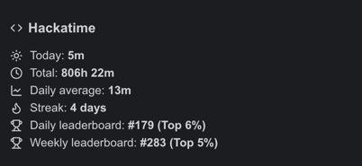
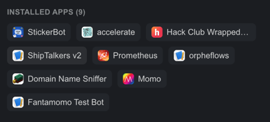
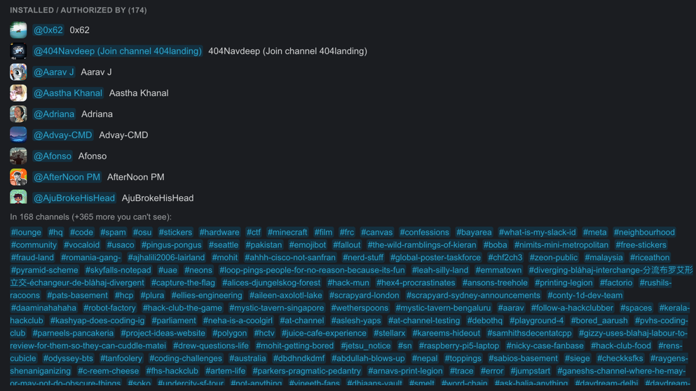
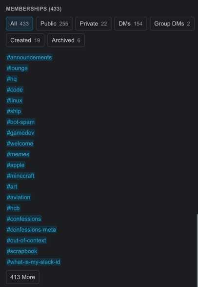
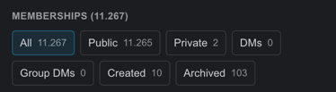
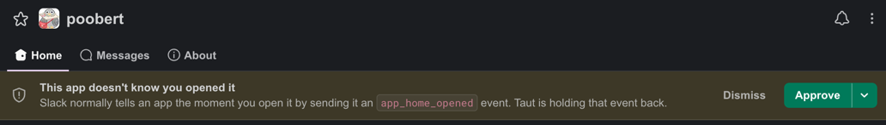

> If you read this you surely came from [Terra](https://terra.hackclub.com). (If not, check it out)

This is my fork of [jeremy46231/taut](https://github.com/jeremy46231/taut).

Maybe you use Taut or Slick.  
If you don't, you need to try them!  
But in short, they modify Slack and add some new cool features.

I added some plugins and created PRs to [jeremy46231/taut](https://github.com/jeremy46231/taut), but they are still pending.

Plugins I added:

1. [App Home Gate](plugins/AppHomeGate.tsx) [[PR](https://github.com/jeremy46231/taut/pull/37)]
2. [Installed Apps](plugins/InstalledApps.tsx) [[PR](https://github.com/jeremy46231/taut/pull/33)] (already in [Slick](https://github.com/3kh0/slick/pull/373))
3. [Hackatime Stats](plugins/HackatimeStats.tsx) [[PR](https://github.com/jeremy46231/taut/pull/34)]
4. [User Memberships](plugins/UserMemberships.tsx) [[PR](https://github.com/jeremy46231/taut/pull/40)]

Want to try them yourself? Read [this](#i-want-them)

Read the PRs to see what the plugins do.

## I want them!

Good, it simple, there are to ways:

But before that, you need taut:

If you want to use the **desktop** version, download it from [here](https://github.com/jeremy46231/taut) (it is signed)  
But if you want to use the browser extension, you need to download it from [my release page](https://github.com/Fantamomo/taut/releases/tag/latest),
because there was an error in the upstream repository, which would block you from importing my plugins.

### Way one: The simplest way

After successfully downloaded it and logging in, check what you downloaded and follow the steps for each platform:

- **Desktop**: Click in the menu bar on the `Taut` button and select `Change App Source`.
- **Userscript**: Tampermonkey icon while on Slack then `Options` or [taut.jer.app/options](https://taut.jer.app/options)
- **Extension**: Manage extensions and then Taut, and then something like `Options`/`Config` or if available press the Taut icon next to the search bar and then `Options`/`Config`

In the now opened window paste the following URL:

```
https://github.com/Fantamomo/taut/releases/download/latest/taut.js
```

After that press `Save` and restart Taut, or press `STRG+SHIFT+R`/`CMD+SHIFT+R` to force reload it.

After that you only need to enable the plugins in the `Preferences` menu. Open it. Select `Taut`.  
And search for the plugins and enable them.

The easiest way to check if they works, is to any user profile and scroll down to the bottom of the page. You should see all installed apps, the Hackatime stats, the user memberships.

Now you can enjoy them! (Please leave feedback)

### Way two: The other way

> Sometimes the first does not work and fails with an CORS error, i dont know why, or how and i wasnt able to reproduce it,
> so if it happens to you, please let me know.

On the release page, there are also the plugins in JS, which you can download. After that open the slack settings,
go to taut then open the `Advanced` tab, scroll down to `Install a plugin` and press `Choose file...`
and select the downloaded file.

You might have seen that there is also a `or paste a URL to a .js file` input filed. Just use the following urls:

```
https://github.com/Fantamomo/taut/releases/download/latest/AppHomeGate.js
https://github.com/Fantamomo/taut/releases/download/latest/HackatimeStats.js
https://github.com/Fantamomo/taut/releases/download/latest/InstalledApps.js
https://github.com/Fantamomo/taut/releases/download/latest/UserMemberships.js
```

## But why did I do this?

Well i wanted this features, but taut or slick didn't have them. So i made them myself.
Also made PRs to the upstream repo, but they are still not merged.

## I want to see them before I install them?

Yeah sure, here are some screenshots:

  
The hackatime stats plugin shown on the user profile (that are my stats)

  
All the apps I have installed on my Slack account

  
This are all the users that authed @at-channel, and also in which channels @at-channel is

  
All the channels I am member of (no I am not going to show you my private channels or DMs)

  
The user memberships plugin shown on a user with a lot of channels (The plugin needs 16 requests to load all of them)

  
This banner is shown on every app home, to block the app home event from be sent to the app (you can allow it)
